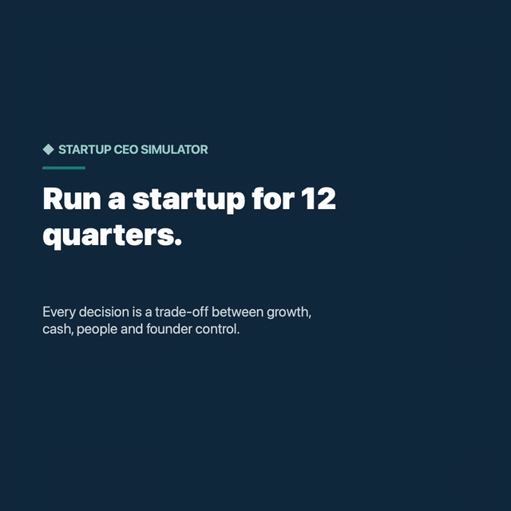
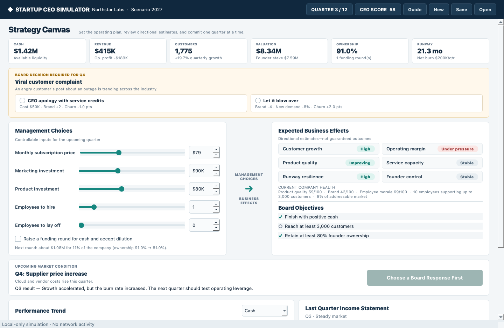

# Startup CEO Simulator

Startup CEO Simulator is an offline strategic-management game built for MBA presentations. The player leads a fictional SaaS company through 12 quarters, balancing growth, profitability, product strength, people, liquidity, valuation, and founder control.

The experience is deliberately approachable: decisions are connected to visible business effects through a transparent rules engine, making the application useful as an interactive case study for professors, recruiters, and potential employers.

## Demo

[](docs/media/startup-ceo-demo.mp4?raw=true)

*47-second walkthrough. Click the preview for the full-quality MP4.*



## Why I built this project

I built Startup CEO Simulator to turn MBA concepts into an interactive decision-making experience. Instead of presenting strategy, finance, and operations as separate topics, the simulator shows how a CEO's choices affect one another over time: aggressive growth can reduce runway, hiring can expand capacity while increasing fixed costs, and outside funding can protect the business while diluting founder ownership.

The project also gave me a practical way to connect business analysis with software development. My goal was to create a portfolio piece that demonstrates how I approach ambiguous problems, translate business ideas into clear rules, and communicate tradeoffs through an accessible product. It is designed to encourage discussion rather than produce a single “correct” strategy.

## Strategy Canvas

The primary screen places controllable management choices beside estimated business effects:

- Set monthly subscription price, marketing and product investment.
- Hire or lay off employees; the interface prevents both in one quarter, and layoffs cannot take the team below three people. Headcount changes and funding are one-off actions and reset after each quarter.
- Raise funding when additional runway justifies founder dilution; the canvas shows the size of the next round and its dilution before you commit.
- Review directional estimates for growth, margin, quality, service capacity, runway, and control, plus live warnings when runway is short or customers are outgrowing the team.
- Respond to seeded market events such as economic slowdowns, supplier increases, competitor outages, privacy concerns, and market expansion.
- Resolve board dilemmas: in four quarters of every game the board brings a decision, such as an acquisition offer, a security vulnerability, a poached engineer, or a price war. Each response shows its direct consequences, and the quarter cannot be committed until you choose one.
- Commit the strategy and immediately see the resulting revenue, profit, customers, cash, valuation, quality, and morale, with a narrative that explains what drove the quarter.
- Follow a quarter-by-quarter trend chart (cash, revenue, operating profit, customers, valuation) and the last quarter's income statement.
- Use a scenario code so every team in a class faces the same market, and open the in-app **Guide** for the rules and scoring.
- Keyboard shortcuts: Ctrl+Enter commits the quarter, Ctrl+N/S/O start, save, and open (⌘ on macOS).

Directional previews are explicitly estimates. Actual results reflect the selected strategy, company health, and the quarter's market condition.

## Board objectives

Every simulation tracks three goals from the opening briefing through the final report:

1. Finish with positive cash.
2. Reach at least 3,000 customers.
3. Retain at least 80% founder ownership.

## Save, resume, and reporting

Sessions can be saved to a local JSON file and reopened later. Saves include current company metrics, the random seed, decision history, market-event history, and board-objective progress. Unsupported, incomplete, and corrupted files are rejected with a helpful message.

At the end of the simulation, the final board report summarizes:

- CEO score with a component breakdown, valuation, cash, customers, founder ownership, and founder stake value
- Best-performing quarter
- Board-objective results
- Major hiring, layoff, funding, and product-investment decisions, including any quarters where support capacity was overloaded
- Every board dilemma and the response chosen
- A concise assessment of what worked and what could improve
- A quarter-by-quarter results table and a full decision log

The report can be exported as a professionally formatted PDF.

## MBA concepts demonstrated

| Concept | Simulation application |
|---|---|
| Unit economics | Price, variable cost, acquisition investment, and churn jointly affect profit |
| Capital allocation | Cash is distributed among product, marketing, talent, and runway protection |
| Price elasticity | Premium pricing raises revenue per customer while pressuring demand and retention |
| Differentiation and pricing power | Higher product quality makes buyers less price-sensitive and softens premium-price churn |
| Diminishing returns | Marketing generates leads through a square-root response curve; product investment lifts quality along a square-root curve |
| Market saturation | Acquisition slows as the company captures more of a growing addressable market |
| Capacity planning | Each employee supports about 300 customers; growing past the team raises churn and lowers quality and morale |
| Operating leverage | Headcount expands capacity while adding recurring payroll and onboarding cost |
| Growth versus profitability | Growth can increase valuation while shortening runway |
| Venture finance | Funding adds cash while progressively diluting founder ownership; the score rewards the founder's stake, not raw cash |
| Stakeholder management | Layoffs lower cost but damage morale and retention |
| Strategic trade-offs and ethics | Board dilemmas weigh short-term cash against trust, focus, talent, and control; covering up a security flaw costs more than disclosing it |
| Build, buy, or partner | Acquisitions, integration partners, and marketplaces offer faster growth at the cost of cash, margin, or ownership |
| Risk management | Repeatable external events test whether a strategy is resilient |

The model is educational and explainable rather than predictive or investment advice.

## Install and launch

Python 3.11 or newer is required.

```bash
python3 -m venv .venv
source .venv/bin/activate
python -m pip install -e '.[dev]'
python main.py
```

After editable installation, the console command is also available:

```bash
startup-ceo-simulator
```

On Windows, activate the environment with `.venv\Scripts\activate`.

## Test and visual QA

Run the full engine, persistence, report, and GUI test suite:

```bash
QT_QPA_PLATFORM=offscreen python -m pytest -q
```

Generate a deterministic local dashboard preview:

```bash
QT_QPA_PLATFORM=offscreen python scripts/capture_screenshot.py
```

The generated image is written to `work/dashboard-preview.png` and is intentionally ignored by Git.

Render a captioned 1080×1080 demo video of a scripted playthrough (requires `ffmpeg`):

```bash
QT_QPA_PLATFORM=offscreen python scripts/make_demo_video.py
```

The video is written to `work/startup-ceo-demo-linkedin.mp4`. The copy shown at the top of this README lives in `docs/media/`, with a GIF preview made from it.

## Project structure

```text
.
├── main.py                         # Application entry point
├── scripts/
│   ├── capture_screenshot.py       # Deterministic visual-QA helper
│   └── make_demo_video.py          # Captioned demo video of a scripted playthrough
├── src/startup_ceo/
│   ├── app.py                      # Strategy Canvas and interaction flow
│   ├── dilemmas.py                 # Board dilemmas and their seeded schedule
│   ├── engine.py                   # PySide6-independent simulation rules
│   ├── formatting.py               # Shared money formatting
│   ├── models.py                   # Typed business and history models
│   ├── report_service.py           # Board summary and PDF export
│   ├── save_service.py             # Validated local JSON persistence
│   └── widgets.py                  # Reusable PySide6 presentation widgets
└── tests/
    ├── test_engine.py              # Financial and deterministic behavior
    ├── test_gui.py                 # Offscreen interface smoke test
    ├── test_report_service.py      # Report content and PDF verification
    └── test_save_service.py        # Round-trip and corruption handling
```

## Simulation model

Each quarter applies the upcoming seeded market event and grows the addressable market (2% a quarter, more in a market-expansion quarter). It then estimates marketing leads with diminishing returns, scales them by the share of the market still unwon, and converts demand according to price, brand, and quality. Price sensitivity falls as product quality rises. New sign-ups are limited by team capacity.

Board dilemmas are scheduled from the scenario code: four distinct dilemmas, drawn from a pool of nine, land between Q2 and Q12. A chosen response takes effect at the start of its quarter and can change cash, operating expenses, customers, headcount, quality, brand, morale, founder ownership, demand, revenue, revenue share, and churn for that quarter. Options that need more cash than the company holds cannot be chosen, unless a funding round raised in the same quarter covers the cost.

Churn depends on quality, morale, premium pricing, and support load: when customers exceed what the team can support (300 per employee), churn rises and quality and morale fall. The engine then recognizes quarterly subscription revenue, deducts variable costs, payroll, marketing, product, overhead, and hiring or severance costs, updates company health and cash, and estimates valuation from annualized revenue, growth, margin, quality, and liquidity. The company fails if cash falls below -$250K.

The CEO score (0 to 100) combines the founder's stake value (valuation × ownership, 35 points), compound customer growth (20), cash on hand (10, full marks at $1M so a late funding round is not a shortcut), product quality and morale (15), the board objectives (5 each), and finishing the last quarter profitable (5).

Using the same scenario code and decisions produces the same results, enabling fair classroom comparisons between growth-first, capital-efficient, and product-led strategies. In balance testing across 20 scenarios, well-run growth-led, premium product-led, and balanced plans score roughly 80 to 94, a hands-off default plan scores in the high 60s, raising money every quarter scores about 50, and doing nothing fails. Within each board dilemma, the defensible responses land within a few points of each other, while cutting corners (such as patching a breach quietly) costs points.

## Privacy and offline operation

All calculations, saves, screenshots, and PDF reports remain on the user's computer. The application has no accounts, uploads, telemetry, analytics, advertising, API integrations, or runtime network calls.

## AI-assisted development

I used AI-assisted tools during development to help explore implementation approaches, draft and refine code, troubleshoot issues, develop test cases, and improve documentation. I directed the product concept, requirements, business assumptions, and design decisions, then reviewed, tested, and refined the resulting work.

AI is not part of the running simulation. The application does not call an AI model or send player data to an external service; outcomes come from the deterministic, locally executed rules described above.

## License

Released under the [MIT License](LICENSE).
